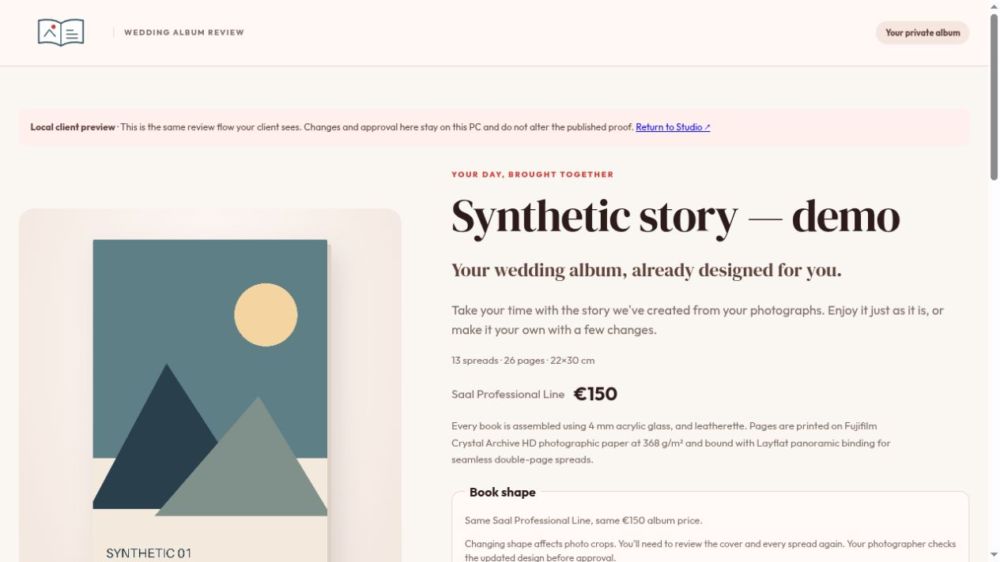
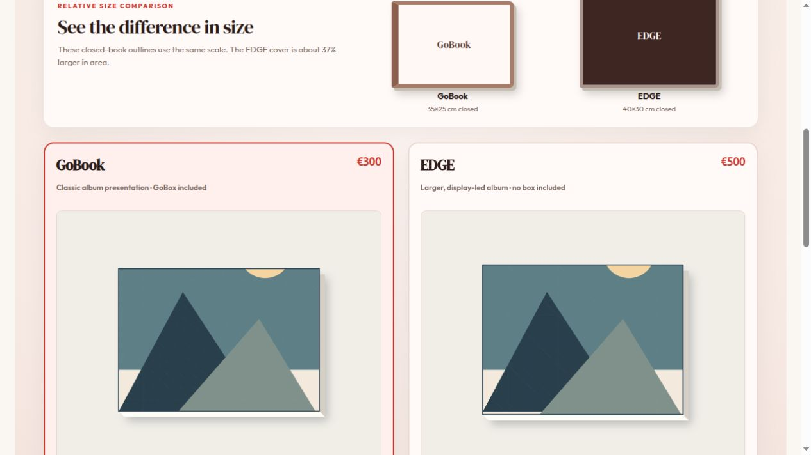

# Album Atelier

An experimental album-design Studio with protected client proofs, timestamp-based
drafts, revision-aware approval and manual print-file exports.

This is a standalone, sanitised reference implementation developed alongside a
private PicPeak deployment. It is **not a native PicPeak module or a supported
public-server installer**. It contains no client photographs, credentials,
deployment history, supplier mockup images or production configuration.



Generated geometric artwork and sample pricing; no client photographs.

## Try the synthetic demo

Requires Linux/macOS, Python 3.11+ and a modern browser. The file-locking code uses
Unix `fcntl`; native Windows is not supported. The standalone demo needs no
PicPeak installation, Docker, GPU, model, Stripe account or cloud service.

```sh
python3 -m venv .venv
. .venv/bin/activate
python -m pip install -r requirements.txt
python scripts/create_demo.py
./start-studio.sh
```

Open **http://127.0.0.1:8775** and select **Synthetic story — demo**. The seed script
creates 26 original geometric images with recorded UTC capture times and a
13-spread Saal portrait draft. All demo files stay in ignored `data/`; running the
seed again reuses its existing demo project. No review is published or approved.

Browse the draft, change layouts/crops and use **Client Preview** to inspect the
client interface. Preview runs on another loopback port, opens through a one-use
link and keeps changes in an isolated snapshot. It cannot take payment. To try
timestamp selection, select the generated images and choose **Build from
timestamps**. The 50–100 target is bounded by the eligible photos available.

To upload your own photos, use JPEG/PNG files with permission. Keep `data/` private
and backed up. It contains originals, designs, proof credentials and approvals.

## What works here

- Manual photo upload, curation, chronological selection, layouts and crop editing.
- Timestamp-only draft suggestions, priorities/exclusions and visible metadata
  fallbacks. Timestamps do not recognise wedding moments or judge expressions.
- Explicit proof publication, isolated local previews, client layout proposals,
  photographer adoption and approval of the exact revision and source hashes.
- Frozen catalogue offers, compatible book-shape choices and approval invalidation
  when the layout, shape or source photos change.
- Graphistudio GoBook/EDGE interior export and Saal Professional Line PDF profiles.
  Export coverage differs by product: see [the output contract](docs/OUTPUTS.md).
- Neutral, original cover illustrations. These show approximate proportions, not
  a supplier's exact cover construction, room scene, material or colour.



Sample retail values and supplier-format presets are included for development;
they are not current supplier prices or a recommendation for your business.
Manufacturing dimensions are separate from the retail catalogue. Verify the
exact product, lab requirements, output and a physical sample before fulfilment.

## Boundaries and safety

Studio is for a trusted operator and binds to loopback. It has no multi-user
photographer permission model. Do not expose `server.py` directly to the Internet.
The optional proof server is a different component and requires a reviewed proxy,
TLS, isolation, private storage, backups and an appropriate retention policy before
external use. Remote publication is unconfigured by default.

The legacy PicPeak/CRM adapters use deployment-specific container internals and
privileged local Docker access. They are provided as integration reference code,
disabled until configured, and need a supported native permission/storage API
before general PicPeak use. No print-shop service or private gallery deployment is
included. See [configuration and integration](docs/INTEGRATION.md) and
[security boundaries](SECURITY.md).

Album payments are not production-ready: the retained adapter accepts test-mode
credentials only, and Saal ordering/payment remains manual. Do not add live keys.
No generation, preview, publication or approval automatically submits a lab order.

## Tests

```sh
python -m pip install -r requirements-dev.txt
python -m unittest discover -s tests -p 'test_*.py'
npm test
python scripts/check_public_release.py
```

The backup tests need `tar` and `zstd` (`sudo apt install zstd` on Ubuntu/Debian).
JavaScript tests need Node.js 22+ and have no npm runtime dependencies. The optional
browser regression in `tests/browser/` additionally needs Playwright and Chromium.
Automated CI runs synthetic fixtures; it does not access galleries or lab accounts.

## Relationship to PicPeak

The shared product configurator, guided configuration, album generator and print
commerce remain complementary workstreams. This snapshot does not claim native
PicPeak authentication, storage/backend portability or a completed upstream port.

- [Product configuration](https://github.com/PicPeak/picpeak/issues/1924)
- [Timestamp-first album draft proposal](https://github.com/PicPeak/picpeak/issues/2251)
- [Guided album/cover/poster configuration](https://github.com/PicPeak/picpeak/issues/2320)
- [Print sales](https://github.com/PicPeak/picpeak/issues/48)

## Licence

Code and the new neutral logo/illustrations are MIT licensed. The bundled fonts
retain their SIL Open Font Licences. See [LICENSE](LICENSE),
[third-party notices](THIRD_PARTY_NOTICES.md) and [asset provenance](ASSETS.md).
Graphistudio, Saal Digital and PicPeak names identify integrations/presets; this
project is not endorsed by those organisations.
